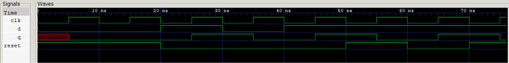
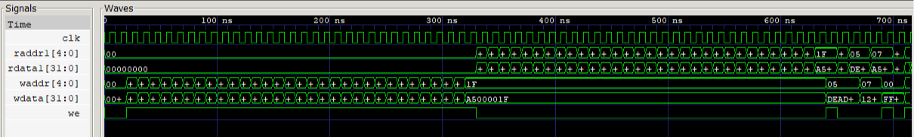
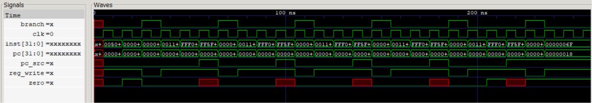

# Design log

Engineering log: what was built, what broke, how it was found, how it was fixed. Newest entries at the bottom.

## Part 1: building blocks and self-checking tests

### 1. 2:1 mux with an exhaustive test

Built `rtl/mux2.v`, a 1-bit 2:1 mux using one continuous assignment, and `tb/tb_mux2.v`, a self-checking testbench. The testbench applies all 8 input combinations. Expected outputs are worked out from the mux rule, not copied from the design. Each output is compared with `!==`, failures are counted, and the last line prints PASS or FAIL.

Result: PASS, 8 of 8 cases, simulation ends at 80 ns. The mux is 1 bit wide for now and will be widened when the datapath needs 32-bit muxes.

### 2. Deliberately broken mux

To check that the test can fail, I swapped the inputs: `assign y = sel ? a : b;`. With the first 4-case version of the testbench, 2 of 4 cases failed (a=1 b=0 sel=0 and a=1 b=0 sel=1). The two cases where a equals b still passed, because a swapped mux gives the same output when both data inputs are equal.

Lesson: a bug can hide behind a badly chosen set of cases. The final testbench uses all 8 combinations. Restored the correct line and PASS returned.

### 3. An unknown output passed with `!=`

I set `assign y = 1'bx;` to simulate a dead design. With `!==` in the testbench, all 8 cases failed. After changing the comparison to `!=`, the testbench printed PASS. The reason: `x != 0` evaluates to x, not true, and an `if` only acts on true, so the FAIL message was skipped and the error counter stayed 0.

Fix: use `!==` for every comparison in testbenches. Restored both files and PASS returned.

### 4. D flip-flop with synchronous reset

Built `rtl/dff_sync_reset.v` and `tb/tb_dff_sync_reset.v`. The testbench changes inputs at the falling clock edge and reads `q` 1 ns after the rising edge, so it never changes an input at the instant the flip-flop samples it. Checks: a reset to remove the power-up `x`, six clocked steps (including reset winning over d=1), and a final block that raises reset and confirms `q` stays 1 until the next rising edge.

The clock starts as `x`, and `x` to 0 counts as a falling edge. A `#1` before the first step makes the first wait end at the real falling edge at 10 ns.

Result: PASS, simulation ends at 76 ns.

`q` is `x` until the first rising edge. After that it changes only just after rising edges. Near 70 ns, `reset` rises while `q` stays 1, and `q` falls at the next rising edge.

### 5. Asynchronous reset: only one check caught it

I changed the sensitivity list to `always @(posedge clk or posedge reset)`, which makes the reset asynchronous. The testbench reported exactly 1 error, from the final block. The six `step` checks all passed.

Reason: `step` reads `q` 1 ns after a rising edge. At that moment the synchronous and asynchronous designs both show 0. They differ only between the moment reset rises (a falling edge) and the next rising edge, and only the final block looks there.

Lesson: a test catches only differences at the moments it looks. A behaviour that matters needs a check at a moment where a correct and a wrong design differ. Restored the line and PASS returned.

### 6. Run script

Added `sim/run.cmd`, which runs one module's test: `sim\run.cmd mux2`. It moves to the repo root first, so the waveform path always works. It stops if the compile fails, so an old compiled file from an earlier run is never executed by mistake. It is Windows-only for now. The all-tests runner comes in Part 6.

## Part 2: ALU, register file and program counter

### 7. ALU with ten operations and a zero flag

Built `rtl/alu.v` and `tb/tb_alu.v`. The ALU implements the ten RV32I integer operations (add, sub, and, or, xor, sll, srl, sra, slt, sltu) and a zero flag. All ten operations were built up front, because the 4-bit operation code is the interface the control logic will use later, and changing it would mean retesting both modules.

The testbench has 40 directed checks. The expected values were worked out by hand and never copied from the design's output. Edge cases: `7FFFFFFF + 1` (wraps), `0 - 1`, shifts by 31 and by 32 (only the low 5 bits of the shift amount count), slt and sltu on operands with different sign bits, and an unused operation code (must give 0).

### 8. ALU: bugs introduced on purpose, and which checks caught them

Four bugs were introduced one at a time to confirm the testbench can fail.

- slt written as `$signed(a) < b`. Verilog treats an expression as signed only if all its operands are signed, so this comparison became unsigned. 2 of 40 checks failed: only the two slt checks whose operands have different sign bits. The other four slt checks still passed. Fix: both operands `$signed`.
- sra written without `$signed`. The `>>>` operator then shifts in zeros. 3 of 40 checks failed. The check with a positive input passed, because sign fill and zero fill are the same for positive numbers.
- sll shifting by all of `b` instead of `b[4:0]`. 1 of 40 checks failed: the one with shift amount 32.
- zero flag written as `(a == b)` instead of `(y == 0)`. 6 of 40 checks failed, all of them cases where the result is zero but the inputs differ.

Lesson: a check is only worth something if it can tell a correct design from a wrong one. Several of these bugs were caught by exactly one check.

### 9. Testbench timing for clocked designs

Convention used by the register file and program counter testbenches: inputs change at the falling clock edge, combinational outputs are checked 1 ns after the inputs change, and clocked outputs are checked 1 ns after the next rising edge.

Changing an input at the rising edge would race with the design sampling that input (the order is undefined). Reading a clocked output at the exact rising edge could return the value from before the nonblocking update. Each testbench task lasts one clock period (10 ns).

### 10. Register file

Built `rtl/regfile.v` and `tb/tb_regfile.v`: 32 registers of 32 bits, two combinational read ports, one clocked write port with a write enable, and x0 that always reads 0 and ignores writes. Decision: no reset. x1 to x31 start as `x` in simulation, so a read before any write shows up in a test instead of being hidden by a zero.

The testbench has 38 checks: x0 reads 0 before anything is written; every register is written with a different value and read back with the two ports on different registers; a write does not disturb its neighbours; nothing is written when the enable is low; x0 ignores writes; and a read of a register in the same cycle as its write shows the old value until the clock edge, then the new value.

At 710 ns the inputs change on the falling edge, but `rdata1` still shows the old value `A5000009`. At 715 ns, on the rising edge, the write lands and `rdata1` shows `0BADF00D`.

### 11. Register file: bugs introduced on purpose

- Read guard removed on port 1: 2 of 38 checks failed (x0 read as `x`, because nothing ever writes it).
- Write enable ignored: 1 of 38 checks failed, the only one with the enable low and a different write value. In the other cycles the stale address and data just rewrote the same value, which is invisible.
- `rdata2` using `raddr1` (a copy-paste bug): 31 of 38 failed. It passes only when both ports read the same register, which is why the test reads different registers on the two ports.
- x0 write guard removed: all 38 checks still passed. While the read guard forces x0 to 0, a value stored in x0 cannot be seen from outside, so no test can fail on this guard. It stays in the design to state the intention clearly.

### 12. Program counter

Built `rtl/pc_reg.v` and `tb/tb_pc_reg.v`: a 32-bit register with synchronous reset to 0 and a `pc_plus4` output. No enable, because the single-cycle core loads a new value every cycle.

The testbench has 18 checks: `pc` is unknown before the first clock edge and 0 after reset (with a non-zero `next_pc`, so reset must win); `pc` follows `next_pc`, including a jump, a large address, and `FFFFFFFC + 4` wrapping to 0; reset in the middle of a run, held for two cycles, then released. Every step also checks that `pc` has not changed before the rising edge.

Bugs introduced on purpose:

- `PC + 1` instead of `PC + 4`: 8 of 18 checks failed, one in every step.
- Reset removed: 6 checks failed from one bug. The first failure (at 6 ns) pointed to the cause; the later ones followed from it.
- `next_pc` ignored (`pc <= pc_plus4`): 6 checks failed. The first two steps passed, because their `next_pc` happened to equal `pc + 4`. The first failure was the jump.

## Part 3: immediate generator and memories

### 13. Immediate generator

Built `rtl/immgen.v` and `tb/tb_immgen.v`. The module takes a 32-bit instruction and a 3-bit format select (I, S, B, U or J) and rebuilds the 32-bit immediate. It rearranges the scattered instruction bits, puts back the implied bit 0 of the B and J formats, and sign-extends from instruction bit 31. An unused select gives 0. It is combinational: an `always @(*)` with a `case` and a `default`.

The testbench has 59 checks, with expected values worked out by hand from the instruction format tables. They are: named instructions for each format (the `addi` and `bne` encoded by hand earlier, a `beq` and a `jal` assembled by RARS, and stores and `lui` instructions); the extreme offsets of each format; one-bit-at-a-time vectors for the scrambled B and J formats (a single 1 on each stored instruction bit must appear at the right immediate bit); vectors where every unused instruction bit is 1 (the output must be 0); and an undefined select. R-type instructions are not tested, because they have no immediate and so there is no defined correct output.

Result: PASS, 59 of 59 checks, simulation ends at 590 ns.

### 14. Immediate generator: bugs introduced on purpose

Three bugs were introduced one at a time into the version of the testbench that had 57 checks (before the two RARS vectors were added).

- Two bits swapped inside the B immediate (`imm[5]` and `imm[6]`): 2 of 57 checks failed, the two one-bit checks for those bits. Every named B instruction still passed, because in each of them the two swapped bits happen to be equal.
- Zero extension instead of sign extension in the I format: 3 of 57 failed, the three negative constants. All positive constants passed.
- One sign copy too few in the B format (`{18{inst[31]}}` instead of `{19{inst[31]}}`): the compiler accepted it, because a 31-bit value assigned to a 32-bit `reg` is silently zero-extended. 2 of 57 failed, the two B checks with a negative result.

Lesson: a swapped pair of bits is invisible when the two bits are equal in every test vector, so scattered fields need one-bit-at-a-time vectors, and sign extension needs negative test values. Each bug was undone with `git restore` and PASS returned.

### 15. Instruction memory

Built `rtl/imem.v`, `tb/tb_imem.v` and the test data file `tb/imem_test.hex`. The memory has 1024 words of 32 bits, is read-only, and has a combinational read: `instr = mem[pc[11:2]]`. The PC counts bytes and each instruction is 4 bytes, so the word index is the PC divided by 4, which means dropping the two low bits. Contents are loaded with `$readmemh` at the start of a simulation. The hex file name is a module parameter, so the testbench loads its own file with known contents instead of the program the core will run later. That test file lives in `tb/` next to the testbench, because the test cannot pass without it.

The testbench has 10 checks: the four words at byte addresses 0, 4, 8 and 12; a marker word in the last slot; the two low address bits ignored (addresses 1, 2 and 3 read the same word as address 0); a never-written slot reading `x`; and an address above 4 KiB wrapping around to slot 0.

Result: PASS, 10 of 10 checks, simulation ends at 100 ns. Known limitation: addresses above 4 KiB wrap around without a fault, and misaligned addresses are not checked.

### 16. Instruction memory: bugs introduced on purpose

- Index `pc[7:0]`, using the PC as if it counted words: 7 of 10 checks failed. The passes were address 0, the unfilled-slot check and the wrap-around check. The unfilled-slot check passed by coincidence: the broken design read a different unfilled slot, and `x` equals `x` under `!==`.
- Index `pc[12:2]`, one bit too wide: 1 of 10 failed, only the wrap-around check. Address 0x1000 reached slot 1024, outside the array, which reads `x`. That check exists for this bug, since every address below 4 KiB still worked.
- File load removed: 9 of 10 failed, every check against known contents. Again only the unfilled-slot check passed.

Lesson: a check that expects `x` only proves that an unwritten slot reads `x`. It cannot tell a correct design from one that reads the wrong slot or loads nothing. Checks on known contents catch those.

### 17. Data memory

Built `rtl/dmem.v` and `tb/tb_dmem.v`: 1024 words of 32 bits, a combinational read, and a write on the rising clock edge when the write enable is 1. There is no reset, so unwritten words read `x`, as in the register file. Access is by whole words only. Byte and half-word access (for `lb`, `lh`, `sb`, `sh`) is postponed to the full RV32I core: the first core needs only `lw` and `sw`, and the existing tests will protect the later change to a 4-bit byte enable.

The testbench follows the timing convention of entry 9 (each task lasts one clock period, inputs change at the falling edge). It has 15 checks: an unwritten word reads `x`; a write and a read back; a write attempt with the enable low changes nothing; two addresses do not disturb each other; an overwrite shows the old value before the clock edge and the new value after it; and the two low address bits are ignored.

Result: PASS, 15 of 15 checks, simulation ends at 130 ns.

### 18. Data memory: bugs introduced on purpose

- Write enable ignored: 4 of 15 checks failed. Without the enable the memory writes at every clock edge with whatever is on `wdata`, so even the first clock period, where nothing should be written, stored a 0. The failures were that stray write and three reads that saw leftover data from earlier cycles, including the check built for this bug (a write attempt with the enable low).
- Index `addr[7:0]`: 3 of 15 failed, only the three low-address-bit checks. Writes and reads through the same address still agree under the wrong numbering, so every round trip passed.
- Registered (clocked) read: 10 of 15 failed. Every read returned the data for the previous clock edge's address, one cycle late. In a single-cycle core this would hand `lw` the wrong word, which is why the read has to be combinational.

Not tried: a write on the falling edge. The testbench changes inputs at the falling edge, so the design and the testbench would change at the same instant (a race) and the result would depend on the simulator's event order, not on the design.

## Part 4: control unit and single-cycle core

### 19. Run script and shared codes

The run script compiled only `rtl/NAME.v` with `tb/tb_NAME.v`, which cannot build a core made of several modules. Before changing it I tested the two Icarus flags in a scratch folder. `-y rtl` finds a module that is used but not defined by looking for a file with its name in `rtl/`. `-I rtl` finds `include` files. With only `-I` the compiler reported the module as unknown, with only `-y` it could not open the include file, and with both the compile was silent. I then added `-y rtl -I rtl` to `sim/run.cmd`.

The ALU operation codes and the immediate select codes were each written twice (in the module and in its testbench), and the control unit would have made a third copy. I moved them into `rtl/alu_codes.vh` and `rtl/imm_codes.vh`. Each module includes its header inside its body, so the rest of each file did not change, and all 8 earlier tests still passed. The RISC-V opcodes are not shared this way. The standard fixes them, so the control unit testbench types them again independently.

Two bugs put in on purpose, both in the header:

- `ALU_SUB` renumbered to 10: all 40 checks still passed. The design and its testbench read the same header, so they agree, and the numbering is our own convention.
- `ALU_SUB` given the same number as `ALU_AND`: 2 of 40 checks failed, the two `and` checks. The first matching `case` label wins, so code 2 subtracted.

Lesson: a shared definition removes the risk of two copies disagreeing, but a test that reads the same definition cannot catch a wrong value. Numbers fixed by the standard need an independent copy in the test.

### 20. Control unit

Built `rtl/control.v` and `rtl/result_codes.vh` (the `result_src` codes: 0 ALU result, 1 memory, 2 PC + 4). The unit has three combinational blocks. A validity check decides whether the instruction is exactly one of the 10 supported ones. A main decoder turns the opcode into seven control signals plus a 2-bit class. An ALU decoder turns the class, `funct3`, opcode bit 5 and `funct7` bit 5 into the 4-bit ALU operation. Every output has a default at the top of its block, which is also the all-zero "do nothing" state, so no latch can form.

Two points that mattered:

- `sub` versus `addi`: both have `funct3` = 000. For `addi`, instruction bit 30 is a bit of the constant, not a function code (`addi x2,x2,-4` is `0xFFC10113`, with bit 30 = 1). So `sub` needs opcode bit 5 = 1 (R-type) as well as bit 30 = 1.
- An opcode check is not enough. `bne` has the same opcode as `beq`, and `xor` the same as `add`, so an opcode-only decoder would run `bne` as `beq`. The validity check looks at `funct3` for `lw`, `sw`, `beq` and `addi`, and at `funct3` and the whole `funct7` for the register-register instructions. It does not look at bits that hold a constant (`funct7` for `lw`, `sw`, `beq` and `addi`, and everything but the opcode for `jal`). Anything else gives all-zero outputs, so no register or memory changes and the PC goes to PC + 4. A real core would raise an illegal-instruction exception, and this one does not.

An unknown (`x`) instruction, which is what `imem` outputs after the last program word, also gives definite zeros, because a `case` on an `x` opcode falls to `default`.

### 21. Control unit: testbench and bugs on purpose

`tb/tb_control.v` has 30 checks. Expected values come from the control table, and the opcodes are typed again in the testbench. Groups: the 10 supported instructions; two `addi` with `funct7` bits set (`7F` and `20`); five checks that ignored fields stay ignored; 12 unsupported instructions (`bne`, `lb`, `sb`, `xor`, `mul`, `andi`, `lui`, `jalr`, `ecall`, a zero opcode, and two register-register instructions with a wrong `funct7`) that must give all zeros; and an all-`x` input that must give definite zeros.

Result: PASS, 30 of 30 checks, simulation ends at 300 ns.

Bugs put in on purpose:

- Dropped the opcode-bit-5 term from the `sub` rule: 2 of 30 failed, the two `addi` checks with `funct7` bits set. The plain `addi` passed, which is why those two checks exist.
- Made the `lw` validity check look at `funct7`: 1 of 30 failed, the `lw` with `funct7` = `7F`. A real `lw` with a negative offset would have been dropped.
- Disabled the validity check: 8 of 30 failed, the unsupported instructions whose opcode is one of the supported ones. `bne` ran as `beq`.
- Removed one default (`result_src`): 25 of 30 failed. A path that does not assign an output keeps the previous value, which is a latch, so outputs depended on the checks before them.

### 22. Core and the first program

Built `rtl/core.v`: ports `clk` and `reset`, and a parameter `PROGRAM` that names the hex file. It connects the PC, instruction memory, control unit, register file, immediate generator, ALU and data memory. The logic it adds is the ALU input b mux, the write-back mux with three inputs, a separate target adder (`pc + imm`, because the ALU is busy comparing the registers for `beq`), `pc_src = (branch AND zero) OR jump`, and the next-PC mux.

Test programs are assembled with RARS. I compared the Code column RARS showed with the words I had worked out by hand before dumping the text segment as hexadecimal text into `tests/NAME.hex`. `tb/tb_core.v` holds one core instance per program, all sharing one clock and reset. Reset is high for exactly one rising edge, because reset only forces the PC to 0 and the instruction at address 0 is live as soon as the PC is 0. Each program runs for 60 cycles and ends in a spin loop (`jal x0, 0`). The testbench reads the registers and memory by hierarchical name, and each program also checks that the PC sits on its spin loop, which proves it finished. Registers have no reset, so every program writes a register before reading it.

The first program, `tests/alu_ops.asm`, runs all five register-register instructions and `addi` on operands chosen so every result differs (12 and 10, a negative operand for `slt`, `addi x12, x2, -4` for the `sub` trap).

Result: PASS, 14 of 14 checks, simulation ends at 606 ns.

### 23. Core: bugs on purpose (first program)

- ALU inputs swapped: 5 of 14 failed, the two `sub` and the three `slt` checks. `add`, `and`, `or` and `addi` gave the same answer in either order.
- Inputs of the `alu_src` mux swapped: 13 of 14 failed. Every `addi` read a register that had not been written, so everything downstream was `x`. Only the PC check passed.
- Testbench watching for only 10 cycles instead of 60: 4 of 14 failed (three registers still `x`, and the PC at `0x28` instead of `0x34`). This is why every program checks its final PC.

Lesson: only non-commutative operations with different operands, used in both orders, can catch swapped operands.

### 24. Remaining test programs

Added five programs, each as `.asm` and `.hex` in `tests/`: `mem_ops` (stores and loads at three addresses with three values, a negative offset and a negative value), `branch_ops` (`beq` taken and not taken, forward and backward), `jal_ops` (forward and backward, the return address, `jal x0`), `loop_sum` (5 + 4 + 3 + 2 + 1 with `beq`, `add`, `addi` and `jal`) and `unsupported` (`xor` and `bne` inside a program must change nothing). Some checks confirm a location was not written: the register a taken branch skips, and `x8` and `x28` in `mem_ops` (for a `sw`, the bits that look like `rd` are offset bits). In `unsupported` the two registers are equal on purpose, because a `bne` misdecoded as `beq` branches only when they are equal.

Result: PASS, 50 of 50 checks, simulation ends at 606 ns.

Two things went wrong on the way:

- RARS rejected the labels `t1` and `t2`, because they are register names (`t1` is `x6`). Floating-point register names such as `f1` would clash too. Renamed the labels (`skip1`, `skip2`, `first`, `second`).
- Every core run prints a `$readmemh` warning, "Not enough words in the file for the requested range [0:1023]", once per program. It is expected: each program is much shorter than the 1024-word memory, and the unwritten words stay `x`. It is left as it is for now.

The PC steps through `00` to `14`, then returns to `08` for each pass of the loop. `pc_src` goes high while the PC is `14` (the `jal` that goes back). After the sixth `beq`, which finds the counter at 0, the PC goes to `18` and stays there.

### 25. Core: bugs on purpose (all programs)

- Branch ignoring the zero flag (`pc_src = branch | jump`): 3 of 50 failed. In `branch_ops` the not-taken `beq` was taken and `x12` stayed `x`. In `loop_sum` the loop left at the first `beq` (`x1` stayed 5 and `x2` stayed 0).
- `jal` storing the target instead of PC + 4: 2 of 50 failed, the two return addresses in `jal_ops` (`x5` was 12 instead of 8, `x6` was 24 instead of 36). The jumps themselves were right.
- Store writing `rdata1` (the base register) instead of `rdata2`: 6 of 50 failed, all in `mem_ops`. Every memory word held 256, and so did the three registers loaded from them.
- Validity check disabled in the control unit: 2 of 50 failed, in `unsupported`. `xor` wrote 10 into `x14` and `bne` branched and skipped `addi x15`. The same bug failed 8 checks in the control unit test, so the same fault is visible at both levels.

Lesson: a test with equal registers catches a `bne` misdecoded as `beq`. With different registers the misdecoded `bne` falls through, just like the correct "do nothing" behaviour, and the bug would hide.

## Part 5: the rest of RV32I

### 26. Control unit interface first, and a safe `unsupported` program

The old `unsupported` program used `xor`, which was about to become supported. Run on the new control unit it would have left `x14` holding the `xor` result instead of the sentinel 77, so the core test would have failed for the right reason, but a commit should pass. The program was rewritten first, around instructions that stay unsupported (`mul`, `fence`, `ecall`, `ebreak`), with one sentinel written before them and one after, so the second sentinel only gets its value if execution flows through all four to PC + 4.

Then the control interface was widened once, to its final size: 13 outputs, 21 bits (`result_src` grew from 2 to 3 bits, and `jalr`, `br_lt`, `br_inv`, `mem_size` and `load_unsigned` were added, all at their default values). The `check` task in `tb_control` was rewritten once, so later builds only add rows. `result_codes.vh` now has five codes at 3 bits, and a new `mem_codes.vh` has the three size codes.

Two bugs put in on purpose did not fail any test. The `result_src` wire in `core.v` left at 2 bits gave a compiler warning (`Port 9 (result_src) of control expects 3 bits, got 2`), and `RES_TARGET = 2'd4` gave `Numeric constant truncated to 2 bits`. Nothing used values above 2 yet, so the truncation changed nothing. Lesson: some bugs no test can see until a feature uses them, and then the compiler warning is the only alarm. The compile checks must print nothing.

### 27. The ALU-type instructions in the control unit

Thirteen instructions (`sll`, `srl`, `sra`, `sltu`, `xor` and eight immediate forms) needed no new datapath: the ALU already had all ten operations, so only the control unit changed. The hard part is instruction bit 30. It is a function code for `sub` (register-register only), and for `sra` and `srai`. For `addi`, `slti`, `sltiu`, `xori`, `ori` and `andi` it is a bit of the constant and must be ignored. For `slli` the whole `funct7` field must be 0. The validity check was extended to check exactly those bits and no others.

`tb_control` was rebuilt with helper tasks (`check_rtype`, `check_itype`, `check_invalid`) so that each row states only what differs, and grew to 60 checks. Bugs put in on purpose: the `slli` `funct7` check removed (2 of 60 failed), `sra` and `srai` decoded as `srl` (2 failed, only the rows with bit 30 set), and the alternate `funct7` accepted for every `funct3` (6 failed: `sll`, `slt`, `sltu`, `xor`, `or` and `and` with `funct7` = `0100000`).

### 28. The `alu_full` program

The program runs the 13 new instructions on inputs 12, 10, -16 and 3, with one result register each and nothing reading a result, so one wrong decode causes only its own failures. The constants are chosen to catch specific bugs: `xor` against `or` needs 12 and 10, `sra` against `srl` and `slt` against `sltu` need a negative number, and `xori -1`, `ori 1024` and `andi 1279` set instruction bit 30. The core test grew to 69 checks.

Bugs put in on purpose: `sra` and `srai` as `srl` (2 of 69 failed), `sltu` and `sltiu` as `slt` (4 failed: the operands with different sign bits), and `xor` as `or` (2 failed).

RARS rejected the first version of the program with `operand is of incorrect type` on `jal x0, 0`: it wants a label as the jump target. The spin loop is now written `spin: jal x0, spin`, which assembles to the same word, `0x0000006f`.

### 29. `lui`, `auipc` and `jalr`

The result mux grew from three inputs to five: `lui` sends the immediate, and `auipc` sends `pc + imm` from the branch target adder, so the ALU is untouched. For `jalr` the ALU adds `rs1` and the constant, and a new `jalr` control signal selects `{alu_y[31:1], 1'b0}` as the next PC. `tb_control` grew to 66 checks.

The `upper_jalr` program covers `lui` with the sign gotcha (`lui` 2 plus `addi -2048` gives `0x1800`), `auipc` at three addresses, a call and return, and a `jalr` with an odd offset that skips one instruction. Bugs put in on purpose: `jalr` without clearing bit 0 failed only the final PC check (1 of 85), because the instruction memory ignores the two low address bits and still fetched the right word, while the PC register held an odd number. `auipc` returning the immediate instead of `pc + imm` failed 3, and `jalr` storing the target instead of PC + 4 failed 1. Lesson: the final-PC check of every program is what catches the first bug.

### 30. The other branches

The ALU is reused: `bne` subtracts like `beq`, `blt` and `bge` run `slt`, `bltu` and `bgeu` run `sltu`, and the answer is bit 0 of the ALU result. The decision is `taken = (br_lt ? alu_y[0] : zero) ^ br_inv`, where `br_lt` and `br_inv` are `funct3` bits 2 and 0. Deciding by the sign of the subtraction was rejected because it is wrong on overflow (`0x7FFFFFFF - 0xFFFFFFFF` gives `0x80000000`). A new ALU class `CLASS_BRANCH` replaced `CLASS_SUB`. `tb_control` grew to 74 checks.

The `branch_all` program has 16 cases, each leaving 1 (taken) or 0 (not taken), covering equal operands, both orders, different sign bits and the overflow pair. Bugs put in on purpose: the answer never inverted failed 8 of 102 (`bne`, `bge`, `bgeu`), `bltu` and `bgeu` using the signed compare failed 5 (cases with different sign bits), and a validity check that accepted the reserved `funct3` values failed 2 rows in the control test and nothing in the core test, since no program contains a reserved branch.

### 31. Data memory with a byte enable

`dmem` now takes a 4-bit byte enable instead of a write enable, written as four independent lane writes. The change was done in two stages. First only the port changed, and the old 15 whole-word checks still passed at 130 ns, which showed nothing else had changed. The core was given a temporary `{4{mem_write}}` connection. Then 13 lane tests were added (28 checks, 250 ns), using words with different bytes so that a lane mix-up shows.

Bugs put in on purpose: a whole word written whenever any lane was enabled failed 9 of 28 while all 15 old checks passed, and swapped enables for lanes 0 and 1 failed 7 (including a cascade, where later checks compared against the right value while memory held the wrong one). Lesson: the old tests protect the old behaviour, not the new one.

### 32. The store and load alignment blocks

`store_align` makes the byte enable and the write data: `be` is the lane pattern gated by `mem_write`, and the data repeats the byte or half-word on every lane (`{4{rs2[7:0]}}`), so no shifter is needed. `wdata` is not gated, because memory ignores it when `be` is `0000`. Its testbench has 11 checks. Bugs put in on purpose: `sb` taking the wrong byte failed 4, the lane using only the low address bit failed 2 (lanes 2 and 3), and `be` not gated by `mem_write` failed 3.

`load_align` picks the byte or half-word from the memory word and extends it with one gate: the fill bit is the top bit AND NOT `load_unsigned`. Its testbench has 14 checks on the word `0x80FF7F01`, which has two bytes with the top bit set. Bugs put in on purpose: `lbu` ignoring the flag failed 2, two byte lanes swapped failed 4, and the two half-words swapped failed 4. Misaligned addresses are not tested, because this core does not define them (a half-word looks only at address bit 1, a word ignores the low two bits).

### 33. Byte and half-word instructions in the core

The core was wired first, with the two new blocks and the control unit still accepting only `lw` and `sw` (size WORD), so the 102 old core checks had to pass unchanged. Then the control unit learned the new `funct3` values with two validity-check lines, because `mem_size` and `load_unsigned` were already produced from `funct3`. `tb_control` grew to 85 checks, with one row for each of the 37 instructions.

The `byte_ops` program (18 checks) reads bytes and half-words of a known word into registers, changes one byte lane at a time with `sb` and reads the word back with `lw`, then changes the two halves with `sh`, and also checks the memory words directly. Bugs put in on purpose: `load_align` bypassed failed 9, `store_align` bypassed failed 5 (and every load check passed, because the loads read a word written by `sw`), and `lbu` and `lhu` sign-extending failed 3.

### 34. A program that uses every instruction group

The `checksum` program fills four bytes in a loop, calls a function (`jal`, `jalr`) that sums and xors them with a loop, combines the results with `lui` constants and shifts, and reads them back as halves and bytes, with a signed `bge` and a `slt` against `sltu` on the same pair. It runs 71 instructions, more than the old 60-cycle run, so the testbench run grew to 100 cycles (`$finish` moved from 606 ns to 1006 ns). Every program ends in a spin loop, so the longer run changed no old result. The core test is now 141 checks.

Bugs put in on purpose: `xor` run as `or` failed 8 (the 2 `alu_full` checks, and six in the new program as one wrong value flowed through the later steps), and `jalr` storing the target instead of PC + 4 failed only the `upper_jalr` check. The new program passed because its `jalr` writes `x0`. Lesson: a big program shows that the parts work together, but it cannot replace the targeted tests.

### 35. What is left out: `fence`, `ecall` and `ebreak`

The core has 37 of the 40 RV32I instructions. `ecall` and `ebreak` need a trap mechanism: control and status registers, a saved PC and cause, a handler address and a return instruction, plus an environment to answer the request. This project has none of these. In this core they do nothing, which is not what a complete core does. A `fence` orders memory accesses as seen by other agents. With one hart, in-order execution, no caches and no devices there is nothing to order, so doing nothing is allowed for a simple core. In all three cases the control unit gives the all-zero row, and `unsupported` checks that they change nothing.

## Part 6: compiled programs and one command for all tests

### 36. From C source to the core: toolchain, flags and memory plan

Installed the xPack GNU RISC-V Embedded GCC 15.2.0-1 from its zip and pinned that version, because compiler output can change between versions. The default target of this toolchain is `rv32imac/ilp32`, which allows multiply and divide instructions and 16-bit compressed instructions, so every compile needs `-march=rv32i -mabi=ilp32`. Two checks on the installed toolchain: `-print-multi-lib` lists an `rv32i/ilp32` library variant, and `-print-libgcc-file-name` with the two flags picks the library from that variant (without the flags it picks the default one). Compiling a small file without the flags showed a real `mul` and 16-bit instructions in the disassembly, which our core could not run.

The C source goes through compile, assemble, link and convert. The conversion uses `objcopy -O binary` for the raw bytes and a short PowerShell script (`sw/bin2hex.ps1`) that joins four bytes into one little-endian word per line. I chose this over the Verilog output of `objcopy`, because that output has byte-address lines and endianness handling that are the subject of binutils bug reports. Raw bytes leave nothing to interpret. The check: the first line of the hex file equals the first instruction word printed by the disassembler.

The linker script places the instruction memory at address 0 and tells the linker that the data memory starts at `0x1000`. Both memories start at 0 in the hardware, but a linker assumes one address space. The data memory looks only at address bits 11 to 2, so `0x1000` reaches its first word. The stack pointer starts at `0x2000`, the end of the data memory. Constants and variables with starting values share one output section, because the data memory has no read-only protection. `-mno-relax` keeps the linker from using the `gp` register shortcut, so the start-up code does not have to set `gp`.

### 37. Initialised data on a Harvard core

The core has two memories, and no instruction can read the instruction memory as data. A compiled program needs its constants and its variables with starting values in the data memory, so a start-up copy loop from instruction memory to data memory cannot be written. The options were: write programs that need no initialised data (the compiler decides that, not the programmer), load the data memory from the testbench by hierarchical name (it breaks when internal names change), give the data memory a hex file like the instruction memory has, or add a read path to the instruction memory (new hardware). I chose the third: `dmem` got a parameter `INIT_FILE`, and `core` got a parameter `DATA` that passes it through. The default is an empty string, meaning no file, so every old test still sees unwritten words as `x`.

The data memory is therefore preloaded at the start of a simulation. A real system would copy the values from flash at boot. This is a simulation shortcut and is stated as such in the README.

### 38. A test-data mistake: two memories on one bus

`tb_dmem` got a second instance loaded from `tb/dmem_test.hex`, sharing the inputs of the first one. The first run of the new checks, before the loading line existed, gave 10 errors instead of the 9 worked out by hand. The extra one was a check at address `0x14` that expected `x` and got `cafef00d`. Reason: the old tests write words 4 and 5 (addresses `0x10` and `0x14`), and the shared bus wrote them into the second memory as well, where my data file also had words. The same collision would have failed two checks after the fix, so the predicted PASS was wrong too.

Fix: the test data moved to words that the old tests never write (0 to 3, 6 and 7), and one check was added on the first instance (word 0 must read `x`). Lesson: instances that share inputs share writes, so before choosing test data, look at what the old tests write. The hand-traced count was what exposed the error. A break on purpose confirmed the new check: with a real file as the default of `INIT_FILE`, exactly 1 of 40 checks failed. The 28 old checks could not see it, because the data file uses words that they never read.

### 39. The first compiled program and the build script

`first.c` has a variable with a starting value (5) and one without (it must be zeroed), and returns 0 + 5 + 7 = 12. The start-up code is 12 instructions: set `sp`, zero the uninitialised variables with a loop, call `main` and spin. From the disassembly, 20 instructions run before the spin loop starts. The core test checks the result, two data-memory words, `sp`, `ra` and the final PC, but not the registers the compiler happened to pick, because another compiler version could pick others. Bugs put in on purpose: `core` forgetting to pass the data file failed 3 of 147 checks (every check that depends on the preloaded value), and the start-up code not zeroing the uninitialised variable failed 2.

`sw/build.ps1` compiles, links and converts one program. It deletes every output first and checks the exit code after every tool, so a failed build leaves no old hex file behind. A syntax error in the C file left no `first.hex` at all, and a code region made too small gave a linker error that said the region overflowed by the size of `main`. A bug of mine in the first version of the script: `"built $Name: ..."` is a parse error in PowerShell, because `$Name:` is read as a variable with a drive prefix. The fix is `${Name}`.

### 40. Done detection instead of a fixed 100 cycles

`tb_core` ran every program for exactly 100 cycles. The compiled programs need more, so the testbench now watches the PC of every core and calls a core done when the PC has no `x` bits and has not changed for 4 clock edges. A timeout of 20000 cycles stops a program that never finishes, and each program has its own `done` check, so a program that timed out is named. Without the check for `x`, a lost core would look done, because `x === x` is true in Verilog. To test that guard, a new program `xpc` jumps through a register that was never written, so its PC becomes `x` for ever, and the testbench checks that it is not done.

Bugs put in on purpose: a stable-count that can never be reached made all 12 `done` checks fail at the timeout (12 of 161 checks, simulation ending at 200011 ns), and removing the `x` guard failed exactly 1 check (`xpc not done`). The slowest program needed 76 cycles at this point. The finish time of the simulation is 10 x cycles + 11 ns, which was confirmed on every run.

The harmless `$readmemh` warning (the hex files are shorter than the memory) is hidden by one narrow filter in `sim/run.cmd`, which drops only the lines containing that message. Everything else, including every `FAIL` line, still shows.

### 41. Real C programs: answers from outside the core

Three programs with answers that come from arithmetic, not from the core. `fib` stores the first 10 Fibonacci numbers (1 to 55) in an array and returns 55. It has one check for something that must not happen: the word just past the array must still be `x`. An off-by-one in the loop (`<=` instead of `<`) failed exactly that one check (word 11 held 89), while all ten correct numbers stayed correct. `sort` is a bubble sort of 5, -2, 9, 1, -7, 3, 8, 4, and the negative numbers are there on purpose. It also counts its swaps, and the count must be 13, because bubble sort does one swap per out-of-order pair and counting the pairs by hand gives 13. `bits` counts the one-bits of `0x80F0A55A` (13) and applies sra, srl, sll, and, or and xor to fixed values.

Two bugs put into the ALU. Making signed less-than unsigned made 10 lines for `sort` fail (the array ended as 1 3 4 5 8 9 -7 -2 with 17 swaps), none for `fib`, `first` or `bits`, because those programs never compare a negative number; the whole core test showed 19 errors, the rest from older tests. Making the arithmetic shift logical failed exactly 1 line for `bits` (`1ffffff8` instead of `fffffff8`). The unit tests say where the bug is, and the programs show that real code runs into it. After these programs the slowest one needed 264 cycles (2651 ns).

### 42. One command for all tests

`sim/run_all.ps1` finds every `tb/tb_<name>.v`, runs it, and prints one line per test and a summary. It ends with exit code 1 if anything failed. The rule is closed: a test passes only if `run.cmd` ended with exit code 0, exactly one line starts with `PASS: ` and no line starts with `FAIL: `. The old `.vvp` file is deleted before each test, so a stale file cannot be run.

Writing it showed that the PASS lines come in four formats: seven testbenches print `PASS: NAME, N checks, 0 errors`, three print `PASS: tb_NAME - all N checks passed`, `mux2` prints `all 8 cases correct`, and `dff_sync_reset` prints no number. The project notes had claimed one format for all. The runner reads a number followed by `checks` or `cases` when it is there, rejects a test that reports 0 checks, and accepts the one without a number. The old testbenches were left unchanged, since they pass and were verified.

Breaks on purpose: addition changed to subtraction in the ALU failed exactly `alu` and `core` (10 of 12 passed, exit code 1). A missing semicolon in `dmem.v` failed exactly `core` and `dmem`, each with exit code 1, no PASS line and no FAIL line, and their old `.vvp` files were gone afterwards. A rule that looked only for FAIL lines would have called both passed.

### 43. Checking the C programs: fresh builds and the instruction gate

The runner also rebuilds each C program, hashes the committed hex files before and after, and fails when they differ, which means a hex file did not match its source. After a failure the freshly built file stays, so the runner repairs it. It then reads the disassembly of the whole linked program and checks that every machine code has 8 digits and every instruction is one of the 37 (or a short name that `objdump` prints for one of them, such as `mv` or `ret`). `ecall`, `ebreak` and `fence` are not on the list. If no instruction line is found, the check fails, so a broken pattern cannot give a silent pass. Without the toolchain, the C checks print a visible `SKIP` line, and `-Strict` turns that into a failure.

Breaks on purpose: one changed word in `fib.hex` failed only `c:fib` (15 of 16), all testbenches stayed green because the rebuild had repaired the file, and `git status` was clean afterwards. An `ebreak` hidden in a branch that never runs failed `c:first` with two problems (the hex file out of date, and the unsupported instruction). With the toolchain hidden from the PATH, the run gave 12 of 12 with a SKIP line, and 12 of 13 with `-Strict`. One known limit: the hash comparison assumes that the committed hex files and the freshly built ones use the same line endings, which holds on this Windows setup.

## Part 7: a five-stage pipeline without hazard handling

### 44. Scope: five stages, four registers, and what is left out

Built a 5-stage version of the core, `core_pipe`, next to the single-cycle `core`. The single-cycle core stays unchanged and keeps its 16 tests, and it remains the reference for the cycle-count comparison later. Fetch holds the PC and the instruction memory. Decode holds the control unit, the read ports of the register file and the immediate generator. Execute holds the ALU, the branch decision and the target adders. Memory holds the store and load alignment blocks and the data memory. Write-back chooses the register value and writes the register file. Four pipeline registers sit between the stages (96, 183, 77 and 73 bits, 429 flip-flops in total).

The control signals are decoded once, in Decode, and then travel with their instruction, each one only as far as the stage that uses it. Taking a control signal from the live output of the control unit in a later stage would apply the controls of a younger instruction. This part has no forwarding, no stalls and no flushes, so the core only runs programs without hazards. Simulation can show that the core is correct and how many clock edges a program takes. It cannot show a shorter clock period, because every gate has zero delay in Icarus; that claim has to wait for a timing estimate from synthesis, and it will be an estimate.

### 45. Hazard-free copies of seven programs

Two properties of the design decide which programs the pipeline can run. The register file is read without a clock and written at the clock edge, so an instruction in Decode in the same cycle as a write to the same register reads the old value. A consumer must therefore come at least 4 instructions after its producer. And a branch or jump is decided in Execute, two fetches after it, so the two instructions behind a taken jump are fetched anyway. Every branch and jump therefore gets two `nop`s behind it.

Seven programs got copies in `tests/pipe/`, with the same instructions in the same order and only `nop`s added: `alu_full`, `mem_ops`, `byte_ops`, `branch_all`, `jal_ops`, `loop_sum` and `upper_jalr`. Padding moves instructions, so the values that depend on addresses were recomputed. The spin addresses became 96, 44, 188, 360, 68, 48 and 116, `x6` of `jal_ops` became 60, the `auipc` and link values of `upper_jalr` changed, and the odd-offset `jalr` there went from offset 13 to 33 (still odd, so the bit-0 test stays). In `loop_sum` the two `nop`s behind `jal x0, loop` also provide the 4-instruction gap between the counter update and the next `beq`.

`li` with a large constant expands to two dependent instructions, so such pairs were written out as `lui` and `addi` with `nop`s between them. No script pads the programs: it would first have to expand the pseudo-instructions and then fix the branch offsets, which is more risk than typing a few `nop`s. The hex files were checked by word count and by the position of one known instruction word and the spin word before any design ran them. Their first real run came in the testbench of the pipelined core.

### 46. A reusable pipeline register

`pipe_reg` is one parameterised row of D flip-flops with a synchronous reset, a flush input that clears it to zeros (a bubble: with all control signals at zero an instruction slot does nothing) and an enable input that holds its value. Reset and flush are the same hardware; they have separate names because one is global and the other will be a local decision of the hazard logic. When flush and enable are both active, flush wins: a thrown-away instruction must not be held in place. The pipelined core ties enable to 1 and flush to 0 for now.

The testbench uses a width of 40, not 32, with test values that have their top bits set, and checks twice per step: just after the inputs change (the output must still hold the old value, so it is edge-triggered) and just after the clock edge. 30 checks. Bugs put in on purpose: ignoring the enable failed 4 of 30, letting the enable win over flush failed 2, and a register that secretly handled only 32 bits failed 18. The last one compiles without any message.

### 47. Fetch and Decode, and a stage test

The pipeline registers are single wide vectors: the signals are joined with `{ }` going in and split with `assign { } =` coming out, with the same order on both sides, and every signal carries a stage prefix (`if_`, `id_`, `ex_`, `mm_`, `wb_`). The first test is a stage test: an 11-instruction program in `tb/pipe_stage_test.hex` with hand-worked expected values for every field in IF/ID and ID/EX after every clock edge. The registers are preloaded by the testbench with k times 0x01010101, because nothing could write them yet, so every register has a different value.

The test shows what travels without being used: for `addi x5, x1, 7` the register file still reads x7, because bits 24:20 of the word hold the immediate, and for a store or a branch the `rd` field is a part of the immediate and is carried along, with `reg_write` at 0. Bugs put in on purpose: swapping two fields when packing ID/EX failed 20 of 140 checks, taking `rd` from the `rs2` field failed 10, and swapping the names of `br_lt` and `br_inv` when unpacking failed exactly 1. That last bug is only visible because `bltu`, the one instruction with different values for the two bits, is in the program. Without it the bug would have passed.

### 48. Execute and Memory

Execute has the same equations as the single-cycle core. A mux merges `pc + 4`, the immediate and `pc + imm` with the ALU result into one value, `ex_result`, so only one 32-bit value travels towards Write-back. This saves about 190 flip-flops compared with carrying all five sources, and it costs one mux delay in Execute. The branch decision and the `jalr` target use the ALU result directly. The data a store writes is the raw `rs2` value, not the ALU's second input, which is the offset.

Once the redirect was live, the stage-test program of the previous step had to change, because a taken `jal` redirects the PC and nothing flushes the two instructions behind it. I found this while planning the step by hand, before anything ran. The `jal` moved to the end of the program, the `bltu` operands were swapped so it is not taken, and the `sw` base register changed so that its address is word aligned (misaligned accesses are not supported). The loaded value that reaches MEM/WB is unknown for every instruction that is not a load; it is never used for them. Bugs put in on purpose: `auipc` taking the ALU result failed 2 of 261 checks, store data taken from the ALU's second input failed 6, and `jal` not redirecting failed 4.

### 49. Write-back, and the first padded program

Write-back is a two-way choice between the loaded value and `ex_result`, and the register file write port gets the destination register number that travelled with its instruction. The three write-back wires had to be declared above the register file instance, because a name used before its declaration is a silent one-bit wire or an error. Every register of the stage test is checked twice: it still holds its preloaded value at edge `i + 4`, and the new value at edge `i + 5`. Three more checks show that a store, a `beq` and a `bltu` do not write the register named in their `rd` field.

The first padded program, `alu_full`, ran on a second instance with a hand-checked spin at edge 26 and a fixed wait. Bugs put in on purpose: Write-back ignoring the loaded value failed 1 of 302 checks, the register file ignoring `reg_write` failed 5 (the three no-write checks, and two more because the corrupted register is read by the `bltu` two edges later), and the write address taken from the instruction in Decode instead of the one in Write-back failed 36 (14 in the stage test and 22 in `alu_full`), because every result lands in the register named by an instruction three places younger.

### 50. Done detection and cycle counts for the pipeline

The done rule of the single-cycle testbench, a PC that has not changed for 4 edges, can never fire on a pipeline. After the spin `jal` is fetched at address S, the fetch stage runs on to S + 4 and S + 8, and the jump sends the PC back to S, so the PC cycles through three values. The new rule: for each core the testbench looks at the instruction in Execute. If it is a taken jump, the PC has no unknown bits and the address it jumps to equals its own address, the spin is found. The testbench then waits 4 more edges so that the older instructions in Memory and Write-back finish (2 are needed, 4 is the margin), and checks the registers, the memory and the spin address. The timeout is still 20000 cycles.

The edge at which the spin is found is checked too, and it can be worked out by hand: the number of instructions fetched before the spin, counting the two wrong-path `nop`s behind every taken jump, plus 3. The results are 27, 14, 50, 84, 18, 50 and 37 for the seven programs, and the slowest is done after 88 edges. The test has 388 checks and ends at 891 ns. I had planned to run every program on the single-cycle core as well and compare the registers, but dropped it: hierarchical names cannot be looped over, so it needs about 430 typed names, and the expected values already come from outside both cores.

Bugs put in on purpose: a `jalr` that keeps bit 0 of its target failed exactly 1 of 388 checks. Every register was right, and only the spin address (117 instead of 116) showed the bug. Ignoring the branch inversion bit flipped the result of 8 branch groups and moved the spin from edge 84 to 86, which failed 9 checks.

### 51. What the pipeline cannot do yet, shown by a program

To see a real hazard, I swapped two lines in `tests/pipe/mem_ops.hex`, so that the first `sw` runs one instruction earlier. It then reads `x1` only 3 instructions after `addi x1` wrote it and sees the old, unknown value. The store writes an unknown word to memory and the later `lw` loads it. Exactly 2 of 388 checks failed (`x6` and the memory word), and the spin address and cycle counts did not change. That is the situation the padding avoids.

Hazard handling is the next step. A value that a consumer needs is already inside the pipeline one register ahead, so forwarding can take it from there for ALU results. A load is different: its data only comes out of the data memory in the Memory stage, one stage too late for the next instruction, so a load followed directly by its user needs one stall cycle even with forwarding. A taken branch or jump needs the two instructions behind it flushed, which costs 2 cycles. The original programs and the C programs are not run on `core_pipe` yet, because they contain all three hazards.

## Part 8: hazard handling for the pipeline

### 52. Scope: three hazards, one mechanism each

The pipeline of Part 7 could only run padded programs. This part makes it handle the three hazards, with one mechanism for each. A data hazard (a register read just after it is written) is solved by forwarding the value from the pipeline register that holds it. A load followed by its user cannot be forwarded in time, so it gets a one-cycle stall. A taken branch or jump gets a flush of the two instructions behind it. Each mechanism got its own test before the next one was started, and the single-cycle core stays untouched as the reference.

Decisions made first, with the reason: the register file keeps its old behaviour (a read in the same cycle as a write gets the old value), because the single-cycle core needs it; an instruction such as `addi x1, x1, 1` must read the old `x1`. The same-cycle case is handled by a bypass in `core_pipe` instead. The program counter gets an enable input for the stall. The load-use detector is precise, meaning it decides from the opcode which registers an instruction really reads. The new programs go into `tests/hazard/` and run as more instances of `tb_core_pipe`. Every test prediction (values and the clock edge at which a program ends) is worked out by hand before the run. The rule for the ending edge is the fetch slot of the spin (counting the two wrong-path instructions behind every taken jump) plus 3, plus one for every stall cycle.

### 53. ID/EX carries the source register numbers

Forwarding compares the source register numbers of the instruction in Execute with the destinations ahead of it, but the numbers were thrown away after Decode. ID/EX grew from 183 to 193 bits (rs1 and rs2 right after rd), and the four registers now hold 439 flip-flops. The stage test reads the registers by name, so only 26 checks were added (2 per edge), and the expected numbers are typed by hand from the instruction table, not sliced from the instruction word, so that a wrong slice cannot be copied into both the design and the test. 388 checks became 414.

Bugs put in on purpose: swapping rs1 and rs2 when unpacking failed 20 of 414 checks, and taking rs2 from the rs1 bits failed 10. Both compile without any message and are visible only because rs1 and rs2 differ in 10 of the 11 stage-test instructions.

### 54. The forwarding unit

`fwd_unit` is a small combinational module: for each of the two source registers it chooses the register value, the EX/MEM result or the MEM/WB data. A source qualifies only if that instruction writes a register (`reg_write`), the destination is not x0, and the numbers are equal; EX/MEM wins because it holds the newer instruction. The test has 20 directed cases and four sweeps over all register numbers, 788 checks, ending at 394 ns. One directed case checks that an instruction in EX/MEM that writes nothing must not hide an older writer in MEM/WB.

Bugs put in on purpose: reversed priority failed 1 of 788, forwarding x0 failed 5, ignoring `reg_write` for MEM/WB failed 1, and a 4-bit register-number compare failed 31. The last one compiles silently and would pass any test that uses only registers below x16; the directed case with numbers differing only in bit 4 and the sweep find it.

### 55. Forwarding wired in, and the first hazard program

Two 3-input muxes sit right after ID/EX, before the ALU's `alu_src` mux, and their outputs feed the ALU, the data of a store, the branch comparison and the `jalr` base. The order matters: a false match (an `addi` whose immediate bits look like the register written just before) puts a forwarded value on an operand the instruction ignores, and the immediate still wins because the forwarding comes first. A store takes its data from the forwarded value, not from the ALU's second input. The forwarded values are `mm_result` and `wb_data`, never the raw loaded value, which is unknown for every instruction that is not a load.

The new program `hazard_alu` has 45 instructions with no `nop`s for data hazards: chains at distances 1 and 2 on both operands, two writers of one register, a write to x0, stores of just-written registers, a false match, and a branch and a `jalr` on a register written one instruction earlier. It ends at edge 43 with the spin at address 168, both worked out by hand. 33 checks, 447 in total.

Bugs put in on purpose: store data not forwarded failed 3 (only the memory words were wrong, every register was right), ALU b not forwarded failed 5, and the MEM/WB path missing for rs2 failed 2.

### 56. The Write-back bypass for distance 3

An instruction three places behind its producer is in Decode while the producer is in Write-back. The value is on the wires to the register file but is written only at the clock edge, so the read gets the old value, and one cycle later the producer has left the pipeline. A bypass inside `regfile` would fix this, but the single-cycle core shares that module and needs the old value (`addi x1, x1, 1`); with the bypass the instruction would read its own result and form a combinational loop. So the bypass is in `core_pipe`, right after the register read, with the same three conditions as the forwarding unit. The order of authority is EX/MEM, MEM/WB, the bypass, the register file.

`bypass_d3` (43 instructions, spin at 160, ends at edge 43) reads at distance 3 on rs1, rs2, store data and a load result, reads x0 after an `addi x0`, reads a register named by the `rd` bits of a store, and has an instruction that needs the bypass on one operand and forwarding on the other. It also reads a load result at distance 2, which the earlier program did not cover. 469 checks. Bugs put in on purpose: no bypass for rs1 failed 4, no bypass for rs2 failed 8 (three directly, five because an unknown value reached memory and was loaded back), and dropping the x0 check failed 1. The count worked out by hand for the last one was 2: the trace had taken the return target of `jalr x0, x9, 0` in `upper_jalr` to be an instruction that reads x0, but it returns to a `nop` that ignores the value. The x0 rule is therefore exposed only by `bypass_d3`.

### 57. A program counter with an enable

`pc_reg` got an `en` input: low holds the PC, and reset wins. Both cores had to connect it. The first run after adding the port, with the old testbench that did not connect it, failed 11 of 18 checks: an unconnected input floats to `z`, `if (z)` is false, and the PC never moved. The single-cycle core ties `en` to 1 and keeps its 208 checks. The PC testbench grew from 18 to 28 checks (hold twice, resume, reset while the enable is low). Bugs put in on purpose: ignoring the enable failed 4 of 28, and reset not winning over a low enable failed 2. Only a test that resets while the enable is low can see the second one.

### 58. The load-use detector

`hazard_unit` asks for a stall when the instruction in Execute is a load, its destination is not x0, and the instruction in Decode really reads that register. "Really reads" is a whitelist of opcodes: rs1 for loads, stores, branches, `jalr` and the two ALU groups, rs2 for stores, branches and register-register instructions. `lui`, `auipc`, `jal`, the all-zero bubble and unknown opcodes never stall. The precision matters because an `addi` has no rs2 and its immediate bits can look like the load's destination: the stall would still give correct values and only cost a cycle, so it would show up only in the cycle counts.

The test has 29 directed cases and five sweeps (all 128 opcodes with a match on rs1 only and on rs2 only, every register number, every one-bit-different number, and a producer that is not a load), 504 checks. Bugs put in on purpose: counting rs2 as always read failed 129 (the false stalls), dropping the x0 check failed 3, ignoring the load flag failed 32, and a typo in one opcode failed 6. The sweep over all 128 opcodes is what finds the typo that makes a wrong opcode count as a store.

### 59. The stall, counted

A stall holds the PC and IF/ID and flushes ID/EX, and the load goes on. Both holds are needed. The program `load_use` has 31 instructions with six stall cycles: a load followed by its user on rs1, on rs2, as store data, in a branch, and in a pointer chase (a load whose result is the base address of the next load), plus two pairs that must not stall. It ends at edge 36 (25 executed instructions, 3, 6 stalls, and 2 for the taken branch). The testbench also counts the cycles in which the stall signal is 1, because values alone cannot show a missing or an extra stall. 497 checks.

Bugs put in on purpose: a stall that never happens failed 7 (every consumer got the load's address instead of its data, and the ending edge was 30), and holding the PC but not IF/ID failed 7. In that second case five consumers were never executed and the instruction behind each one ran twice, so the ending edge stayed at 36: the lost and the duplicated instructions cancel in the cycle count, and only the values and the stall count show the bug. A third break, removing the bubble from ID/EX, was not run because its effect depends on stale values in a branch compare and could not be worked out by hand.

### 60. The flush, with harmful instructions on the wrong path

On a taken branch, `jal` or `jalr`, IF/ID and ID/EX are flushed; EX/MEM and MEM/WB are not, so a `jal` still writes its link register. `jalr` is not part of the branch-taken signal, so the redirect is the OR of both. A stall and a flush cannot happen in the same cycle, since a load and a branch cannot both be in Execute, so no extra logic was added; a monitor in the testbench counts the cycles in which both are 1 in every instance, and one check requires the count to be 0. In the stage test the entry after the `jal` is now a bubble, which changed two expected values at edge 12 (planned in advance); the seven padded programs and the three earlier hazard programs kept their results and their ending edges.

The padded programs could never show that a flush works, because a `nop` does nothing even if it runs. `flush_ctl` (40 instructions, spin at 156, ends at edge 47) puts a register write and a memory write right behind every taken jump, and nothing follows the spin. Bugs put in on purpose: not flushing ID/EX failed 7 (the first wrong-path register writes ran, and the stage test saw the instruction in ID/EX), not flushing IF/ID failed 5 (the four poison stores and a loop counter), and leaving `jalr` out of the redirect failed 2. The monitor was checked by making it fire: counting a stall or a redirect gave 25, which is 6 stall cycles, 1 redirect, and 18 redirects of the spin. The spin redirects only every third cycle, because each taken jump costs two bubbles; the count worked out by hand had assumed every cycle and was wrong by a factor of 3. A break that also flushed EX/MEM was not run: it would lose the link register that `upper_jalr` returns through, so that program never reaches its spin. 532 checks.

### 61. A first run of the original programs

Before writing this up, a throwaway testbench outside the repository ran all 16 original programs (the 12 assembly programs and the 4 C programs) on the single-cycle core and on `core_pipe` side by side, and compared registers x1 to x31 and all 1024 data words after 2000 cycles. They were identical for all 16. To check that the comparison can fail, the load-use stall was removed: three programs then differed (`c_sort`, `c_first` and `checksum`), which shows that compiled code contains loads followed directly by their users. This run is not part of the repository. Turning it into a committed test, with the cycle counts of both cores, is the next part.

### 62. What the pipeline still does not do

Every taken branch and jump costs 2 cycles, because there is no branch prediction, and every load followed by its user costs 1, including a load followed by a store of the loaded value. The memories still read combinationally, which a real clocked memory would not. Simulation shows that the values and the cycle counts are right; it cannot show the clock period, and the forwarding muxes make the Execute stage longer. The synthesis step will give an estimate and the README will say what it cannot tell. The programs of the single-cycle core have been run on the pipeline only in the throwaway comparison above.
