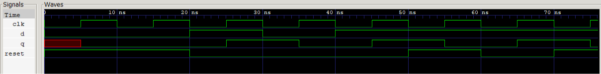
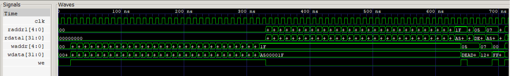
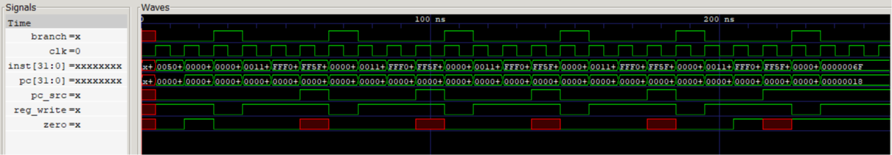

# Design log

Engineering log: what was built, what broke, how it was found, how it was fixed. Newest entries at the bottom.

## Part 1: building blocks and self-checking tests

### 1. 2:1 mux with an exhaustive test

Built `rtl/mux2.v`, a 1-bit 2:1 mux using one continuous assignment, and `tb/tb_mux2.v`, a self-checking testbench. The testbench applies all 8 input combinations. Expected outputs are worked out from the mux rule, not copied from the design. Each output is compared with `!==`, failures are counted, and the last line prints PASS or FAIL.

Result: PASS, 8 of 8 cases, simulation ends at 80 ns. The mux is 1 bit wide for now and will be widened when the datapath needs 32-bit muxes.

### 2. Deliberately broken mux

To check that the test can fail, I swapped the inputs: `assign y = sel ? a : b;`. With the first 4-case version of the testbench, 2 of 4 cases failed (a=1 b=0 sel=0 and a=1 b=0 sel=1). The two cases where a equals b still passed, because a swapped mux gives the same output when both data inputs are equal.

Lesson: a bug can hide behind a badly chosen set of cases. The final testbench uses all 8 combinations. Restored the correct line and PASS returned.

### 3. An unknown output passed with `!=`

I set `assign y = 1'bx;` to simulate a dead design. With `!==` in the testbench, all 8 cases failed. After changing the comparison to `!=`, the testbench printed PASS. The reason: `x != 0` evaluates to x, not true, and an `if` only acts on true, so the FAIL message was skipped and the error counter stayed 0.

Fix: use `!==` for every comparison in testbenches. Restored both files and PASS returned.

### 4. D flip-flop with synchronous reset

Built `rtl/dff_sync_reset.v` and `tb/tb_dff_sync_reset.v`. The testbench changes inputs at the falling clock edge and reads `q` 1 ns after the rising edge, so it never changes an input at the instant the flip-flop samples it. Checks: a reset to remove the power-up `x`, six clocked steps (including reset winning over d=1), and a final block that raises reset and confirms `q` stays 1 until the next rising edge.

The clock starts as `x`, and `x` to 0 counts as a falling edge. A `#1` before the first step makes the first wait end at the real falling edge at 10 ns.

Result: PASS, simulation ends at 76 ns.

`q` is `x` until the first rising edge. After that it changes only just after rising edges. Near 70 ns, `reset` rises while `q` stays 1, and `q` falls at the next rising edge.

### 5. Asynchronous reset: only one check caught it

I changed the sensitivity list to `always @(posedge clk or posedge reset)`, which makes the reset asynchronous. The testbench reported exactly 1 error, from the final block. The six `step` checks all passed.

Reason: `step` reads `q` 1 ns after a rising edge. At that moment the synchronous and asynchronous designs both show 0. They differ only between the moment reset rises (a falling edge) and the next rising edge, and only the final block looks there.

Lesson: a test catches only differences at the moments it looks. A behaviour that matters needs a check at a moment where a correct and a wrong design differ. Restored the line and PASS returned.

### 6. Run script

Added `sim/run.cmd`, which runs one module's test: `sim\run.cmd mux2`. It moves to the repo root first, so the waveform path always works. It stops if the compile fails, so an old compiled file from an earlier run is never executed by mistake. It is Windows-only for now. The all-tests runner comes in Part 6.

## Part 2: ALU, register file and program counter

### 7. ALU with ten operations and a zero flag

Built `rtl/alu.v` and `tb/tb_alu.v`. The ALU implements the ten RV32I integer operations (add, sub, and, or, xor, sll, srl, sra, slt, sltu) and a zero flag. All ten operations were built up front, because the 4-bit operation code is the interface the control logic will use later, and changing it would mean retesting both modules.

The testbench has 40 directed checks. The expected values were worked out by hand and never copied from the design's output. Edge cases: `7FFFFFFF + 1` (wraps), `0 - 1`, shifts by 31 and by 32 (only the low 5 bits of the shift amount count), slt and sltu on operands with different sign bits, and an unused operation code (must give 0).

### 8. ALU: bugs introduced on purpose, and which checks caught them

Four bugs were introduced one at a time to confirm the testbench can fail.

- slt written as `$signed(a) < b`. Verilog treats an expression as signed only if all its operands are signed, so this comparison became unsigned. 2 of 40 checks failed: only the two slt checks whose operands have different sign bits. The other four slt checks still passed. Fix: both operands `$signed`.
- sra written without `$signed`. The `>>>` operator then shifts in zeros. 3 of 40 checks failed. The check with a positive input passed, because sign fill and zero fill are the same for positive numbers.
- sll shifting by all of `b` instead of `b[4:0]`. 1 of 40 checks failed: the one with shift amount 32.
- zero flag written as `(a == b)` instead of `(y == 0)`. 6 of 40 checks failed, all of them cases where the result is zero but the inputs differ.

Lesson: a check is only worth something if it can tell a correct design from a wrong one. Several of these bugs were caught by exactly one check.

### 9. Testbench timing for clocked designs

Convention used by the register file and program counter testbenches: inputs change at the falling clock edge, combinational outputs are checked 1 ns after the inputs change, and clocked outputs are checked 1 ns after the next rising edge.

Changing an input at the rising edge would race with the design sampling that input (the order is undefined). Reading a clocked output at the exact rising edge could return the value from before the nonblocking update. Each testbench task lasts one clock period (10 ns).

### 10. Register file

Built `rtl/regfile.v` and `tb/tb_regfile.v`: 32 registers of 32 bits, two combinational read ports, one clocked write port with a write enable, and x0 that always reads 0 and ignores writes. Decision: no reset. x1 to x31 start as `x` in simulation, so a read before any write shows up in a test instead of being hidden by a zero.

The testbench has 38 checks: x0 reads 0 before anything is written; every register is written with a different value and read back with the two ports on different registers; a write does not disturb its neighbours; nothing is written when the enable is low; x0 ignores writes; and a read of a register in the same cycle as its write shows the old value until the clock edge, then the new value.

At 710 ns the inputs change on the falling edge, but `rdata1` still shows the old value `A5000009`. At 715 ns, on the rising edge, the write lands and `rdata1` shows `0BADF00D`.

### 11. Register file: bugs introduced on purpose

- Read guard removed on port 1: 2 of 38 checks failed (x0 read as `x`, because nothing ever writes it).
- Write enable ignored: 1 of 38 checks failed, the only one with the enable low and a different write value. In the other cycles the stale address and data just rewrote the same value, which is invisible.
- `rdata2` using `raddr1` (a copy-paste bug): 31 of 38 failed. It passes only when both ports read the same register, which is why the test reads different registers on the two ports.
- x0 write guard removed: all 38 checks still passed. While the read guard forces x0 to 0, a value stored in x0 cannot be seen from outside, so no test can fail on this guard. It stays in the design to state the intention clearly.

### 12. Program counter

Built `rtl/pc_reg.v` and `tb/tb_pc_reg.v`: a 32-bit register with synchronous reset to 0 and a `pc_plus4` output. No enable, because the single-cycle core loads a new value every cycle.

The testbench has 18 checks: `pc` is unknown before the first clock edge and 0 after reset (with a non-zero `next_pc`, so reset must win); `pc` follows `next_pc`, including a jump, a large address, and `FFFFFFFC + 4` wrapping to 0; reset in the middle of a run, held for two cycles, then released. Every step also checks that `pc` has not changed before the rising edge.

Bugs introduced on purpose:

- `PC + 1` instead of `PC + 4`: 8 of 18 checks failed, one in every step.
- Reset removed: 6 checks failed from one bug. The first failure (at 6 ns) pointed to the cause; the later ones followed from it.
- `next_pc` ignored (`pc <= pc_plus4`): 6 checks failed. The first two steps passed, because their `next_pc` happened to equal `pc + 4`. The first failure was the jump.

## Part 3: immediate generator and memories

### 13. Immediate generator

Built `rtl/immgen.v` and `tb/tb_immgen.v`. The module takes a 32-bit instruction and a 3-bit format select (I, S, B, U or J) and rebuilds the 32-bit immediate. It rearranges the scattered instruction bits, puts back the implied bit 0 of the B and J formats, and sign-extends from instruction bit 31. An unused select gives 0. It is combinational: an `always @(*)` with a `case` and a `default`.

The testbench has 59 checks, with expected values worked out by hand from the instruction format tables. They are: named instructions for each format (the `addi` and `bne` encoded by hand earlier, a `beq` and a `jal` assembled by RARS, and stores and `lui` instructions); the extreme offsets of each format; one-bit-at-a-time vectors for the scrambled B and J formats (a single 1 on each stored instruction bit must appear at the right immediate bit); vectors where every unused instruction bit is 1 (the output must be 0); and an undefined select. R-type instructions are not tested, because they have no immediate and so there is no defined correct output.

Result: PASS, 59 of 59 checks, simulation ends at 590 ns.

### 14. Immediate generator: bugs introduced on purpose

Three bugs were introduced one at a time into the version of the testbench that had 57 checks (before the two RARS vectors were added).

- Two bits swapped inside the B immediate (`imm[5]` and `imm[6]`): 2 of 57 checks failed, the two one-bit checks for those bits. Every named B instruction still passed, because in each of them the two swapped bits happen to be equal.
- Zero extension instead of sign extension in the I format: 3 of 57 failed, the three negative constants. All positive constants passed.
- One sign copy too few in the B format (`{18{inst[31]}}` instead of `{19{inst[31]}}`): the compiler accepted it, because a 31-bit value assigned to a 32-bit `reg` is silently zero-extended. 2 of 57 failed, the two B checks with a negative result.

Lesson: a swapped pair of bits is invisible when the two bits are equal in every test vector, so scattered fields need one-bit-at-a-time vectors, and sign extension needs negative test values. Each bug was undone with `git restore` and PASS returned.

### 15. Instruction memory

Built `rtl/imem.v`, `tb/tb_imem.v` and the test data file `tb/imem_test.hex`. The memory has 1024 words of 32 bits, is read-only, and has a combinational read: `instr = mem[pc[11:2]]`. The PC counts bytes and each instruction is 4 bytes, so the word index is the PC divided by 4, which means dropping the two low bits. Contents are loaded with `$readmemh` at the start of a simulation. The hex file name is a module parameter, so the testbench loads its own file with known contents instead of the program the core will run later. That test file lives in `tb/` next to the testbench, because the test cannot pass without it.

The testbench has 10 checks: the four words at byte addresses 0, 4, 8 and 12; a marker word in the last slot; the two low address bits ignored (addresses 1, 2 and 3 read the same word as address 0); a never-written slot reading `x`; and an address above 4 KiB wrapping around to slot 0.

Result: PASS, 10 of 10 checks, simulation ends at 100 ns. Known limitation: addresses above 4 KiB wrap around without a fault, and misaligned addresses are not checked.

### 16. Instruction memory: bugs introduced on purpose

- Index `pc[7:0]`, using the PC as if it counted words: 7 of 10 checks failed. The passes were address 0, the unfilled-slot check and the wrap-around check. The unfilled-slot check passed by coincidence: the broken design read a different unfilled slot, and `x` equals `x` under `!==`.
- Index `pc[12:2]`, one bit too wide: 1 of 10 failed, only the wrap-around check. Address 0x1000 reached slot 1024, outside the array, which reads `x`. That check exists for this bug, since every address below 4 KiB still worked.
- File load removed: 9 of 10 failed, every check against known contents. Again only the unfilled-slot check passed.

Lesson: a check that expects `x` only proves that an unwritten slot reads `x`. It cannot tell a correct design from one that reads the wrong slot or loads nothing. Checks on known contents catch those.

### 17. Data memory

Built `rtl/dmem.v` and `tb/tb_dmem.v`: 1024 words of 32 bits, a combinational read, and a write on the rising clock edge when the write enable is 1. There is no reset, so unwritten words read `x`, as in the register file. Access is by whole words only. Byte and half-word access (for `lb`, `lh`, `sb`, `sh`) is postponed to the full RV32I core: the first core needs only `lw` and `sw`, and the existing tests will protect the later change to a 4-bit byte enable.

The testbench follows the timing convention of entry 9 (each task lasts one clock period, inputs change at the falling edge). It has 15 checks: an unwritten word reads `x`; a write and a read back; a write attempt with the enable low changes nothing; two addresses do not disturb each other; an overwrite shows the old value before the clock edge and the new value after it; and the two low address bits are ignored.

Result: PASS, 15 of 15 checks, simulation ends at 130 ns.

### 18. Data memory: bugs introduced on purpose

- Write enable ignored: 4 of 15 checks failed. Without the enable the memory writes at every clock edge with whatever is on `wdata`, so even the first clock period, where nothing should be written, stored a 0. The failures were that stray write and three reads that saw leftover data from earlier cycles, including the check built for this bug (a write attempt with the enable low).
- Index `addr[7:0]`: 3 of 15 failed, only the three low-address-bit checks. Writes and reads through the same address still agree under the wrong numbering, so every round trip passed.
- Registered (clocked) read: 10 of 15 failed. Every read returned the data for the previous clock edge's address, one cycle late. In a single-cycle core this would hand `lw` the wrong word, which is why the read has to be combinational.

Not tried: a write on the falling edge. The testbench changes inputs at the falling edge, so the design and the testbench would change at the same instant (a race) and the result would depend on the simulator's event order, not on the design.

## Part 4: control unit and single-cycle core

### 19. Run script and shared codes

The run script compiled only `rtl/NAME.v` with `tb/tb_NAME.v`, which cannot build a core made of several modules. Before changing it I tested the two Icarus flags in a scratch folder. `-y rtl` finds a module that is used but not defined by looking for a file with its name in `rtl/`. `-I rtl` finds `include` files. With only `-I` the compiler reported the module as unknown, with only `-y` it could not open the include file, and with both the compile was silent. I then added `-y rtl -I rtl` to `sim/run.cmd`.

The ALU operation codes and the immediate select codes were each written twice (in the module and in its testbench), and the control unit would have made a third copy. I moved them into `rtl/alu_codes.vh` and `rtl/imm_codes.vh`. Each module includes its header inside its body, so the rest of each file did not change, and all 8 earlier tests still passed. The RISC-V opcodes are not shared this way. The standard fixes them, so the control unit testbench types them again independently.

Two bugs put in on purpose, both in the header:

- `ALU_SUB` renumbered to 10: all 40 checks still passed. The design and its testbench read the same header, so they agree, and the numbering is our own convention.
- `ALU_SUB` given the same number as `ALU_AND`: 2 of 40 checks failed, the two `and` checks. The first matching `case` label wins, so code 2 subtracted.

Lesson: a shared definition removes the risk of two copies disagreeing, but a test that reads the same definition cannot catch a wrong value. Numbers fixed by the standard need an independent copy in the test.

### 20. Control unit

Built `rtl/control.v` and `rtl/result_codes.vh` (the `result_src` codes: 0 ALU result, 1 memory, 2 PC + 4). The unit has three combinational blocks. A validity check decides whether the instruction is exactly one of the 10 supported ones. A main decoder turns the opcode into seven control signals plus a 2-bit class. An ALU decoder turns the class, `funct3`, opcode bit 5 and `funct7` bit 5 into the 4-bit ALU operation. Every output has a default at the top of its block, which is also the all-zero "do nothing" state, so no latch can form.

Two points that mattered:

- `sub` versus `addi`: both have `funct3` = 000. For `addi`, instruction bit 30 is a bit of the constant, not a function code (`addi x2,x2,-4` is `0xFFC10113`, with bit 30 = 1). So `sub` needs opcode bit 5 = 1 (R-type) as well as bit 30 = 1.
- An opcode check is not enough. `bne` has the same opcode as `beq`, and `xor` the same as `add`, so an opcode-only decoder would run `bne` as `beq`. The validity check looks at `funct3` for `lw`, `sw`, `beq` and `addi`, and at `funct3` and the whole `funct7` for the register-register instructions. It does not look at bits that hold a constant (`funct7` for `lw`, `sw`, `beq` and `addi`, and everything but the opcode for `jal`). Anything else gives all-zero outputs, so no register or memory changes and the PC goes to PC + 4. A real core would raise an illegal-instruction exception, and this one does not.

An unknown (`x`) instruction, which is what `imem` outputs after the last program word, also gives definite zeros, because a `case` on an `x` opcode falls to `default`.

### 21. Control unit: testbench and bugs on purpose

`tb/tb_control.v` has 30 checks. Expected values come from the control table, and the opcodes are typed again in the testbench. Groups: the 10 supported instructions; two `addi` with `funct7` bits set (`7F` and `20`); five checks that ignored fields stay ignored; 12 unsupported instructions (`bne`, `lb`, `sb`, `xor`, `mul`, `andi`, `lui`, `jalr`, `ecall`, a zero opcode, and two register-register instructions with a wrong `funct7`) that must give all zeros; and an all-`x` input that must give definite zeros.

Result: PASS, 30 of 30 checks, simulation ends at 300 ns.

Bugs put in on purpose:

- Dropped the opcode-bit-5 term from the `sub` rule: 2 of 30 failed, the two `addi` checks with `funct7` bits set. The plain `addi` passed, which is why those two checks exist.
- Made the `lw` validity check look at `funct7`: 1 of 30 failed, the `lw` with `funct7` = `7F`. A real `lw` with a negative offset would have been dropped.
- Disabled the validity check: 8 of 30 failed, the unsupported instructions whose opcode is one of the supported ones. `bne` ran as `beq`.
- Removed one default (`result_src`): 25 of 30 failed. A path that does not assign an output keeps the previous value, which is a latch, so outputs depended on the checks before them.

### 22. Core and the first program

Built `rtl/core.v`: ports `clk` and `reset`, and a parameter `PROGRAM` that names the hex file. It connects the PC, instruction memory, control unit, register file, immediate generator, ALU and data memory. The logic it adds is the ALU input b mux, the write-back mux with three inputs, a separate target adder (`pc + imm`, because the ALU is busy comparing the registers for `beq`), `pc_src = (branch AND zero) OR jump`, and the next-PC mux.

Test programs are assembled with RARS. I compared the Code column RARS showed with the words I had worked out by hand before dumping the text segment as hexadecimal text into `tests/NAME.hex`. `tb/tb_core.v` holds one core instance per program, all sharing one clock and reset. Reset is high for exactly one rising edge, because reset only forces the PC to 0 and the instruction at address 0 is live as soon as the PC is 0. Each program runs for 60 cycles and ends in a spin loop (`jal x0, 0`). The testbench reads the registers and memory by hierarchical name, and each program also checks that the PC sits on its spin loop, which proves it finished. Registers have no reset, so every program writes a register before reading it.

The first program, `tests/alu_ops.asm`, runs all five register-register instructions and `addi` on operands chosen so every result differs (12 and 10, a negative operand for `slt`, `addi x12, x2, -4` for the `sub` trap).

Result: PASS, 14 of 14 checks, simulation ends at 606 ns.

### 23. Core: bugs on purpose (first program)

- ALU inputs swapped: 5 of 14 failed, the two `sub` and the three `slt` checks. `add`, `and`, `or` and `addi` gave the same answer in either order.
- Inputs of the `alu_src` mux swapped: 13 of 14 failed. Every `addi` read a register that had not been written, so everything downstream was `x`. Only the PC check passed.
- Testbench watching for only 10 cycles instead of 60: 4 of 14 failed (three registers still `x`, and the PC at `0x28` instead of `0x34`). This is why every program checks its final PC.

Lesson: only non-commutative operations with different operands, used in both orders, can catch swapped operands.

### 24. Remaining test programs

Added five programs, each as `.asm` and `.hex` in `tests/`: `mem_ops` (stores and loads at three addresses with three values, a negative offset and a negative value), `branch_ops` (`beq` taken and not taken, forward and backward), `jal_ops` (forward and backward, the return address, `jal x0`), `loop_sum` (5 + 4 + 3 + 2 + 1 with `beq`, `add`, `addi` and `jal`) and `unsupported` (`xor` and `bne` inside a program must change nothing). Some checks confirm a location was not written: the register a taken branch skips, and `x8` and `x28` in `mem_ops` (for a `sw`, the bits that look like `rd` are offset bits). In `unsupported` the two registers are equal on purpose, because a `bne` misdecoded as `beq` branches only when they are equal.

Result: PASS, 50 of 50 checks, simulation ends at 606 ns.

Two things went wrong on the way:

- RARS rejected the labels `t1` and `t2`, because they are register names (`t1` is `x6`). Floating-point register names such as `f1` would clash too. Renamed the labels (`skip1`, `skip2`, `first`, `second`).
- Every core run prints a `$readmemh` warning, "Not enough words in the file for the requested range [0:1023]", once per program. It is expected: each program is much shorter than the 1024-word memory, and the unwritten words stay `x`. It is left as it is for now.

The PC steps through `00` to `14`, then returns to `08` for each pass of the loop. `pc_src` goes high while the PC is `14` (the `jal` that goes back). After the sixth `beq`, which finds the counter at 0, the PC goes to `18` and stays there.

### 25. Core: bugs on purpose (all programs)

- Branch ignoring the zero flag (`pc_src = branch | jump`): 3 of 50 failed. In `branch_ops` the not-taken `beq` was taken and `x12` stayed `x`. In `loop_sum` the loop left at the first `beq` (`x1` stayed 5 and `x2` stayed 0).
- `jal` storing the target instead of PC + 4: 2 of 50 failed, the two return addresses in `jal_ops` (`x5` was 12 instead of 8, `x6` was 24 instead of 36). The jumps themselves were right.
- Store writing `rdata1` (the base register) instead of `rdata2`: 6 of 50 failed, all in `mem_ops`. Every memory word held 256, and so did the three registers loaded from them.
- Validity check disabled in the control unit: 2 of 50 failed, in `unsupported`. `xor` wrote 10 into `x14` and `bne` branched and skipped `addi x15`. The same bug failed 8 checks in the control unit test, so the same fault is visible at both levels.

Lesson: a test with equal registers catches a `bne` misdecoded as `beq`. With different registers the misdecoded `bne` falls through, just like the correct "do nothing" behaviour, and the bug would hide.

## Part 5: the rest of RV32I

### 26. Control unit interface first, and a safe `unsupported` program

The old `unsupported` program used `xor`, which was about to become supported. Run on the new control unit it would have left `x14` holding the `xor` result instead of the sentinel 77, so the core test would have failed for the right reason, but a commit should pass. The program was rewritten first, around instructions that stay unsupported (`mul`, `fence`, `ecall`, `ebreak`), with one sentinel written before them and one after, so the second sentinel only gets its value if execution flows through all four to PC + 4.

Then the control interface was widened once, to its final size: 13 outputs, 21 bits (`result_src` grew from 2 to 3 bits, and `jalr`, `br_lt`, `br_inv`, `mem_size` and `load_unsigned` were added, all at their default values). The `check` task in `tb_control` was rewritten once, so later builds only add rows. `result_codes.vh` now has five codes at 3 bits, and a new `mem_codes.vh` has the three size codes.

Two bugs put in on purpose did not fail any test. The `result_src` wire in `core.v` left at 2 bits gave a compiler warning (`Port 9 (result_src) of control expects 3 bits, got 2`), and `RES_TARGET = 2'd4` gave `Numeric constant truncated to 2 bits`. Nothing used values above 2 yet, so the truncation changed nothing. Lesson: some bugs no test can see until a feature uses them, and then the compiler warning is the only alarm. The compile checks must print nothing.

### 27. The ALU-type instructions in the control unit

Thirteen instructions (`sll`, `srl`, `sra`, `sltu`, `xor` and eight immediate forms) needed no new datapath: the ALU already had all ten operations, so only the control unit changed. The hard part is instruction bit 30. It is a function code for `sub` (register-register only), and for `sra` and `srai`. For `addi`, `slti`, `sltiu`, `xori`, `ori` and `andi` it is a bit of the constant and must be ignored. For `slli` the whole `funct7` field must be 0. The validity check was extended to check exactly those bits and no others.

`tb_control` was rebuilt with helper tasks (`check_rtype`, `check_itype`, `check_invalid`) so that each row states only what differs, and grew to 60 checks. Bugs put in on purpose: the `slli` `funct7` check removed (2 of 60 failed), `sra` and `srai` decoded as `srl` (2 failed, only the rows with bit 30 set), and the alternate `funct7` accepted for every `funct3` (6 failed: `sll`, `slt`, `sltu`, `xor`, `or` and `and` with `funct7` = `0100000`).

### 28. The `alu_full` program

The program runs the 13 new instructions on inputs 12, 10, -16 and 3, with one result register each and nothing reading a result, so one wrong decode causes only its own failures. The constants are chosen to catch specific bugs: `xor` against `or` needs 12 and 10, `sra` against `srl` and `slt` against `sltu` need a negative number, and `xori -1`, `ori 1024` and `andi 1279` set instruction bit 30. The core test grew to 69 checks.

Bugs put in on purpose: `sra` and `srai` as `srl` (2 of 69 failed), `sltu` and `sltiu` as `slt` (4 failed: the operands with different sign bits), and `xor` as `or` (2 failed).

RARS rejected the first version of the program with `operand is of incorrect type` on `jal x0, 0`: it wants a label as the jump target. The spin loop is now written `spin: jal x0, spin`, which assembles to the same word, `0x0000006f`.

### 29. `lui`, `auipc` and `jalr`

The result mux grew from three inputs to five: `lui` sends the immediate, and `auipc` sends `pc + imm` from the branch target adder, so the ALU is untouched. For `jalr` the ALU adds `rs1` and the constant, and a new `jalr` control signal selects `{alu_y[31:1], 1'b0}` as the next PC. `tb_control` grew to 66 checks.

The `upper_jalr` program covers `lui` with the sign gotcha (`lui` 2 plus `addi -2048` gives `0x1800`), `auipc` at three addresses, a call and return, and a `jalr` with an odd offset that skips one instruction. Bugs put in on purpose: `jalr` without clearing bit 0 failed only the final PC check (1 of 85), because the instruction memory ignores the two low address bits and still fetched the right word, while the PC register held an odd number. `auipc` returning the immediate instead of `pc + imm` failed 3, and `jalr` storing the target instead of PC + 4 failed 1. Lesson: the final-PC check of every program is what catches the first bug.

### 30. The other branches

The ALU is reused: `bne` subtracts like `beq`, `blt` and `bge` run `slt`, `bltu` and `bgeu` run `sltu`, and the answer is bit 0 of the ALU result. The decision is `taken = (br_lt ? alu_y[0] : zero) ^ br_inv`, where `br_lt` and `br_inv` are `funct3` bits 2 and 0. Deciding by the sign of the subtraction was rejected because it is wrong on overflow (`0x7FFFFFFF - 0xFFFFFFFF` gives `0x80000000`). A new ALU class `CLASS_BRANCH` replaced `CLASS_SUB`. `tb_control` grew to 74 checks.

The `branch_all` program has 16 cases, each leaving 1 (taken) or 0 (not taken), covering equal operands, both orders, different sign bits and the overflow pair. Bugs put in on purpose: the answer never inverted failed 8 of 102 (`bne`, `bge`, `bgeu`), `bltu` and `bgeu` using the signed compare failed 5 (cases with different sign bits), and a validity check that accepted the reserved `funct3` values failed 2 rows in the control test and nothing in the core test, since no program contains a reserved branch.

### 31. Data memory with a byte enable

`dmem` now takes a 4-bit byte enable instead of a write enable, written as four independent lane writes. The change was done in two stages. First only the port changed, and the old 15 whole-word checks still passed at 130 ns, which showed nothing else had changed. The core was given a temporary `{4{mem_write}}` connection. Then 13 lane tests were added (28 checks, 250 ns), using words with different bytes so that a lane mix-up shows.

Bugs put in on purpose: a whole word written whenever any lane was enabled failed 9 of 28 while all 15 old checks passed, and swapped enables for lanes 0 and 1 failed 7 (including a cascade, where later checks compared against the right value while memory held the wrong one). Lesson: the old tests protect the old behaviour, not the new one.

### 32. The store and load alignment blocks

`store_align` makes the byte enable and the write data: `be` is the lane pattern gated by `mem_write`, and the data repeats the byte or half-word on every lane (`{4{rs2[7:0]}}`), so no shifter is needed. `wdata` is not gated, because memory ignores it when `be` is `0000`. Its testbench has 11 checks. Bugs put in on purpose: `sb` taking the wrong byte failed 4, the lane using only the low address bit failed 2 (lanes 2 and 3), and `be` not gated by `mem_write` failed 3.

`load_align` picks the byte or half-word from the memory word and extends it with one gate: the fill bit is the top bit AND NOT `load_unsigned`. Its testbench has 14 checks on the word `0x80FF7F01`, which has two bytes with the top bit set. Bugs put in on purpose: `lbu` ignoring the flag failed 2, two byte lanes swapped failed 4, and the two half-words swapped failed 4. Misaligned addresses are not tested, because this core does not define them (a half-word looks only at address bit 1, a word ignores the low two bits).

### 33. Byte and half-word instructions in the core

The core was wired first, with the two new blocks and the control unit still accepting only `lw` and `sw` (size WORD), so the 102 old core checks had to pass unchanged. Then the control unit learned the new `funct3` values with two validity-check lines, because `mem_size` and `load_unsigned` were already produced from `funct3`. `tb_control` grew to 85 checks, with one row for each of the 37 instructions.

The `byte_ops` program (18 checks) reads bytes and half-words of a known word into registers, changes one byte lane at a time with `sb` and reads the word back with `lw`, then changes the two halves with `sh`, and also checks the memory words directly. Bugs put in on purpose: `load_align` bypassed failed 9, `store_align` bypassed failed 5 (and every load check passed, because the loads read a word written by `sw`), and `lbu` and `lhu` sign-extending failed 3.

### 34. A program that uses every instruction group

The `checksum` program fills four bytes in a loop, calls a function (`jal`, `jalr`) that sums and xors them with a loop, combines the results with `lui` constants and shifts, and reads them back as halves and bytes, with a signed `bge` and a `slt` against `sltu` on the same pair. It runs 71 instructions, more than the old 60-cycle run, so the testbench run grew to 100 cycles (`$finish` moved from 606 ns to 1006 ns). Every program ends in a spin loop, so the longer run changed no old result. The core test is now 141 checks.

Bugs put in on purpose: `xor` run as `or` failed 8 (the 2 `alu_full` checks, and six in the new program as one wrong value flowed through the later steps), and `jalr` storing the target instead of PC + 4 failed only the `upper_jalr` check. The new program passed because its `jalr` writes `x0`. Lesson: a big program shows that the parts work together, but it cannot replace the targeted tests.

### 35. What is left out: `fence`, `ecall` and `ebreak`

The core has 37 of the 40 RV32I instructions. `ecall` and `ebreak` need a trap mechanism: control and status registers, a saved PC and cause, a handler address and a return instruction, plus an environment to answer the request. This project has none of these. In this core they do nothing, which is not what a complete core does. A `fence` orders memory accesses as seen by other agents. With one hart, in-order execution, no caches and no devices there is nothing to order, so doing nothing is allowed for a simple core. In all three cases the control unit gives the all-zero row, and `unsupported` checks that they change nothing.
